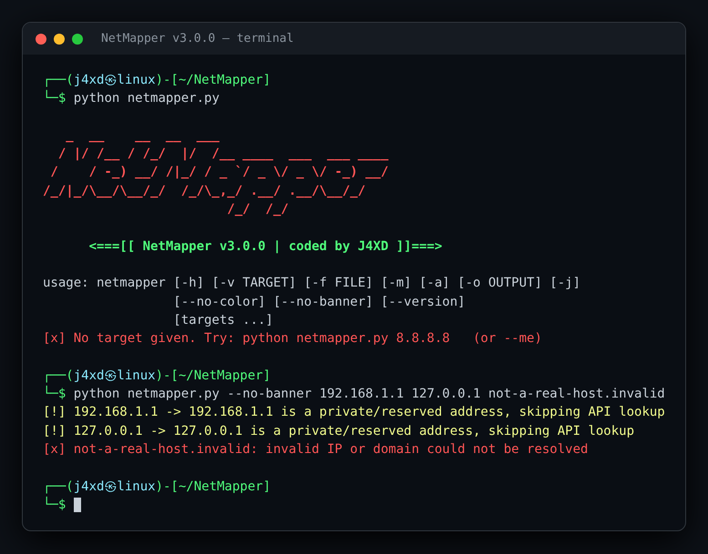

<p align="center">
  
</p>

<p align="center">
  
  
  
  
  
</p>

<p align="center">
  <a href="https://github.com/J4XD"></a>
</p>

---

## `> cat about.txt`

**NetMapper** is a lightweight Python command-line tool for **IP and domain intelligence**.
Give it an IP address or a domain and it returns the location, ISP, ASN, reverse DNS, and
whether the IP belongs to a **VPN / proxy / Tor**, a **datacenter**, or a **mobile network**.
It runs on **Termux** (rooted or not), Linux, Windows and macOS.

> 📍 IP geolocation is **approximate**: it usually points to the ISP's city or region, not to a person's exact location.

---

## `> ./features.sh`

| | Feature |
|---|---|
| 🌍 | Geolocation: continent, country, region, city, district, zip, lat/long, timezone, currency |
| 🛰️ | Network intel: ISP, organisation, ASN / AS name, reverse DNS (PTR) |
| 🕵️ | **Proxy / VPN / Tor**, **Hosting / Datacenter** and **Mobile network** detection |
| 🗺️ | Google Maps link for the coordinates |
| 🎯 | Multiple targets, a target file (`-f`) or stdin (`-`) |
| ⚡ | Batch lookups (up to 100 IPs per request) with automatic rate-limit handling |
| 🔁 | Domain → IP resolution, IPv4 **and** IPv6, with `-a` to look up every resolved IP |
| 🙋 | `--me` looks up your own public IP |
| 💾 | Export to **JSON / CSV / TXT** |
| 🧩 | `--json` output for scripting (`jq`-friendly) |
| 🛡️ | Skips private / reserved IPs, with timeouts and clean error messages |

---

## `> install`

### Termux (Android)

```bash
pkg update -y && pkg upgrade -y
pkg install python git -y
git clone https://github.com/J4XD/NetMapper
cd NetMapper
pip install -r requirements.txt
```

### Linux / macOS / Windows

```bash
git clone https://github.com/J4XD/NetMapper
cd NetMapper
pip install -r requirements.txt
```

**Requirements:** Python 3.7+, `requests`, and an internet connection.

---

## `> usage`

```bash
python netmapper.py <target> [options]
```

| Option | Description |
|---|---|
| `target ...` | One or more IPs / domains (`-` reads from stdin) |
| `-v, --target` | Single target (kept for v2 compatibility) |
| `-f, --file` | File with one target per line (`#` comments allowed) |
| `-m, --me` | Look up your own public IP |
| `-a, --all-ips` | Look up every IP a domain resolves to |
| `-o, --output` | Save results: `.json`, `.csv` or `.txt` |
| `-j, --json` | Print raw JSON to stdout |
| `--no-color` | Disable colours |
| `--no-banner` | Hide the banner |
| `--version` | Show the version |

### Examples

```bash
# Single IP
python netmapper.py 8.8.8.8

# Domain, saved as JSON
python netmapper.py -v github.com -o result.json

# Several targets, exported to CSV
python netmapper.py 1.1.1.1 8.8.8.8 cloudflare.com -o report.csv

# Bulk lookup from a file
python netmapper.py -f targets.txt -o report.txt

# Your own public IP
python netmapper.py --me

# Script-friendly JSON
python netmapper.py 8.8.8.8 --json | jq .country
```

### Sample output

```text
<---------------------------------------->
[$] Target IP         : 8.8.8.8
[$] Reverse DNS       : dns.google
[$] ISP               : Google LLC
[$] Organisation      : Google Public DNS
[$] ASN               : AS15169 Google LLC
[$] Country           : United States
[$] City              : Mountain View
[$] Time zone         : America/Los_Angeles
[$] Proxy / VPN / Tor : no
[$] Hosting / DC      : YES
[$] Google Maps       : https://www.google.com/maps?q=37.4,-122.1
<---------------------------------------->
```

---

## `> screenshots`

<p align="center">
  
</p>

---

## `> notes`

- Data comes from the free [ip-api.com](https://ip-api.com) API (no key needed, limit **45 requests/min**). NetMapper waits automatically when the limit is reached.
- Private and reserved ranges (`127.0.0.1`, `192.168.x.x`, `10.x.x.x`, …) are skipped because they have no public location.
- See [CHANGELOG.md](CHANGELOG.md) for what's new in v3.0.

---

## ⚠️ Disclaimer

NetMapper is made for **educational purposes and authorised security research only**.
It is meant for network administrators, security researchers and cybersecurity learners who
want to understand network infrastructure. Do not use it to track, stalk or harass anyone.
The developer is not responsible for any misuse or damage caused by this tool.

---

<p align="center">
  <b>⭐ If NetMapper helped you, star the repo!</b><br/>
  <sub>Made with 💚 by <a href="https://github.com/J4XD">J4XD</a></sub>
</p>
